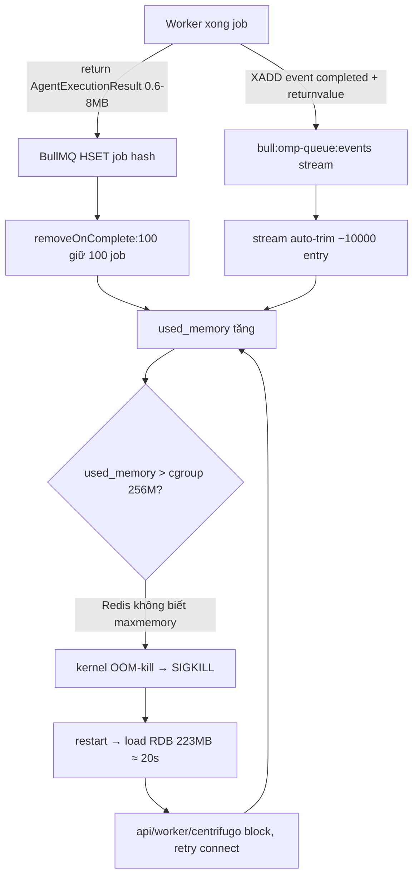

# Research: Triển khai Redis chuẩn cho BullMQ — chặn OOM-kill loop

**Conducted:** 2026-11-17 · **Scope:** Redis 7 container self-host (VPS 3.8 GB RAM, 2 vCPU) làm backend cho BullMQ `omp-queue`; không nghiên cứu Redis Cluster / Sentinel / managed Redis.

## TL;DR

Bạn không có "lỗi Redis". Bạn có **3 lỗi cấu hình chồng nhau**, và Redis đang bị kernel giết vì không ai nói cho nó biết trần của nó:

| # | Lỗi | Bằng chứng | Hệ quả |
|---|---|---|---|
| 1 | `maxmemory` không set, container limit 256 M | `docker-compose.prod.yml` redis service: chỉ có `limits.memory: 256M`, không `command`, không `maxmemory` | Redis tự tin mình có vô hạn → kernel OOM-kill thay vì trả lỗi `OOM command not allowed` |
| 2 | Retention BullMQ quá rộng + return value nhiều MB | `omp-queue.ts:123-124` `removeOnComplete:100`, `removeOnFail:200`; worker `index.ts:29` `return executeOmpJob(...)` → `AgentExecutionResult` chứa `reportMarkdown`, `rawLogs`, `reportJson` | 34 hash × 5–8 MB = ~90 MB giữ vô ích; **không chỗ nào trong repo đọc `returnvalue`** |
| 3 | Events stream giữ 10.000 entry mặc định | `events` stream 194.8 MB / 307 entry ≈ 635 KB/entry | **`XTRIM MAXLEN 50` sẽ không cứu được** — stream tự bơm lại tới ~10k entry → trần lý thuyết ~6 GB |
| 4 | Không có persistence volume, không AOF | redis service không `volumes`, không `command` | RDB nằm trong writable layer của container; `docker compose down` / recreate image = mất sạch job đang chờ. BullMQ production guide: **bắt buộc persistence, ưu tiên AOF** |

Điểm quan trọng nhất: **`docker update --memory 512m` của bạn sẽ bị xoá ở lần `docker compose up -d` kế tiếp**, vì compose vẫn khai 256M. Fix phải vào file compose.

## 1. Cơ chế OOM thật sự (không phải "dataset lớn hơn RAM")



Hai chi tiết dễ bỏ sót:

- **Fork/COW**: RDB snapshot (`save` mặc định bật) và AOF rewrite đều `fork()`. Trong thời gian fork, RSS có thể tạm **gấp đôi** dataset trước khi trang bị copy. Trần container phải chừa chỗ cho đỉnh này, không chỉ cho dataset thường trực ([netdata: Redis fork/COW memory storm](https://www.netdata.cloud/guides/redis/redis-fork-cow-storm/)).
- **`maxmemory` != container limit**: `maxmemory` là ngưỡng *Redis tự nguyện* dừng ở đó (và với `noeviction` thì trả lỗi cho producer). Không set → Redis chỉ chết khi kernel ra tay. BullMQ production guide yêu cầu `maxmemory-policy noeviction` **và** persistence ([docs.bullmq.io/guide/going-to-production](https://docs.bullmq.io/guide/going-to-production)).

## 2. Chuẩn triển khai Redis cho BullMQ (checklist 8 điểm)

1. **`maxmemory` tường minh, `<` container limit ít nhất 1.5–2×.** Queue cần `noeviction` → không bao giờ để Redis tự evict key của BullMQ (evict = mất job âm thầm).
2. **Container limit do compose khai** (không `docker update` tay), gồm headroom cho fork COW + fragmentation + client output buffers.
3. **`maxmemory-clients`** (Redis ≥ 7.0): chặn tổng buffer client. `QueueEvents` đọc entry nhiều MB → output buffer phình theo số consumer.
4. **AOF `everysec` + volume `/data`.** Với queue, RDB mất tới 60s dữ liệu mặc định; AOF `everysec` chỉ mất ≤1s.
5. **`maxmemory-policy noeviction`** — bất biến. `allkeys-lru` trên queue = corrupted state ([dev.to](https://dev.to/subashthiruppathy_5e0f532/why-your-bullmq-redis-job-queue-is-silently-leaking-memory-and-how-to-fix-it-3h28)).
6. **Host kernel**: `vm.overcommit_memory=1`, tắt THP (Redis official khuyến nghị; nếu không, `fork` có thể fail khi COW cần cấp trang).
7. **BullMQ retention phải nhỏ theo *byte*, không theo *count*.** 100 job × 8 MB = 800 MB. Count chỉ an toàn khi payload ≤ vài chục KB.
8. **Không đặt multi-MB trong `job.data` hay `returnvalue`.** Redis là hàng đợi, không phải blob store — trỏ tới path/object storage ([BullMQ auto-removal](https://docs.bullmq.io/guide/queues/auto-removal-of-jobs), [issue #366](https://github.com/taskforcesh/bullmq/issues/366)).

### Quyết định: có cần persistence?

Có, và đây là điểm dễ cắt sai nhất. Redis ở đây không chỉ là pub/sub: nó giữ **job đang chờ + đang chạy** của `omp-queue`. Mất Redis = job biến mất trong khi `ai_jobs` bên Postgres vẫn `running` → finalizer đánh dấu fail sau timeout, credit/audit của user đã trừ mà không có kết quả. BullMQ production guide liệt kê persistence là điều kiện tiên quyết, ưu tiên AOF ([going-to-production](https://docs.bullmq.io/guide/going-to-production)). Hiện tại RDB nằm trong writable layer container (không volume) — tức là "có persistence nhưng không bền": `docker compose down`/recreate image là mất.

Nếu chấp nhận mất job khi Redis chết, phương án thay thế rẻ hơn là **bỏ hẳn BullMQ**, dùng Postgres `ai_jobs` làm queue (`SELECT ... FOR UPDATE SKIP LOCKED`) — một nguồn sự thật, không thêm Redis. Không khuyến nghị: phải viết lại worker + coordinator, và 500 MB Redis vẫn rẻ hơn rủi ro đó.

### Compose đề xuất (redis service)

```yaml
  redis:
    image: redis:7-alpine
    container_name: nexus-redis
    restart: unless-stopped
    stop_grace_period: 30s          # đủ cho AOF flush khi restart (mặc định 10s)
    command:
      - redis-server
      - --appendonly
      - "yes"
      - --appendfsync
      - everysec
      # Tắt RDB snapshot: list YAML = argv thô, không có shell bóc quote,
      # nên `- --save ""` thành 1 argv duy nhất `--save ""` → "Invalid save parameters".
      - --save
      - ""
      - --maxmemory
      - 320mb                        # ~62% của 512m: chừa cho AOF-rewrite COW + fragmentation
      - --maxmemory-policy
      - noeviction
      - --maxmemory-clients
      - 32mb                         # Redis 7: chặn tổng output buffer client phình
      - --lazyfree-lazy-user-del
      - "yes"
    mem_limit: 512m
    memswap_limit: 512m              # swap = memory: cấm swap, fail fast thay vì thrash
    volumes:
      - redis_data:/data
    healthcheck:
      test: ["CMD", "redis-cli", "ping"]
      interval: 5s
      timeout: 3s
      retries: 5
    deploy:
      resources:
        limits: { cpus: "0.5", memory: 512M }
```

Thêm `redis_data` vào block `volumes:` cuối file. `mem_limit` + `deploy.limits.memory` cùng khai để không phụ thuộc phiên bản compose.

### Toán sizing (dùng số đo thật của bạn)

| Hạng mục | Hiện tại | Sau fix |
|---|---|---|
| `bull:omp-queue:events` | 194.8 MB (307 × 635 KB) | `maxLen 500` × vài chục KB ≈ 5–15 MB |
| job hash (data + returnvalue) | 34 × 5–8 MB ≈ 90 MB | 20 job × ~100 KB ≈ 2 MB |
| job log (`job:logs:*`, TTL 24h) | < 1 MB | không đổi (đã có TTL) |
| **Tổng steady state** | ~300 MB (vượt 256) | **~20–30 MB**, đỉnh fork ~60 MB |
| `maxmemory` / container | 0 / 256 MB ❌ | 320 MB / 512 MB ✅ |

→ Sau khi fix, **có thể hạ container về 256 MB**, nhưng giữ 512 MB cho tới khi đo được 1–2 tuần.

## 3. Patch code cần duyệt (chưa áp dụng)

**(a) `apps/api/src/modules/ai-engine/infrastructure/queue/omp-queue.ts:23-24,121-125`**

```ts
const queueOptions = {
  connection,
  streams: { events: { maxLen: 500 } },
};
export const ompQueue = new Queue("omp-queue", queueOptions);
export const ompQueueEvents = new QueueEvents("omp-queue", queueOptions);
```

Và **phải sửa luôn options truyền tay ở `omp-queue.ts:121-125`** — BullMQ cho job options trong `queue.add()` override `defaultJobOptions`, nên khai defaults mà để nguyên 100/200 ở đây là dead code:

```ts
await ompQueue.add("evaluate-omp", payload, {
  jobId: queueJobId,
  removeOnComplete: { age: 3600, count: 20 },
  removeOnFail: { age: 86_400, count: 50 },
});
```

`maxLen` chỉ cần khai trên `Queue`: `Queue` ghi `opts.maxLenEvents` vào hash `bull:omp-queue:meta` khi connect (`skipMetasUpdate` mặc định false), worker đọc lại từ meta đó mỗi lần XADD — xác nhận trong `node_modules/bullmq/dist/esm/classes/queue.js:44,73-76` và `commands/includes/getOrSetMaxEvents.lua`. Khai trên `QueueEvents` là vô hại nhưng không có tác dụng. Mặc định 10.000 entry ([BullMQ events](https://docs.bullmq.io/guide/events)); 10k × 635 KB = 6.35 GB trần lý thuyết — đây là lý do `XTRIM` một lần là vô nghĩa.

**(b) `apps/worker-omp/src/index.ts:29`** — `returnvalue` hiện **không consumer nào đọc** (`grep returnvalue apps/{api,worker-omp}/src` → 0 hit ngoài tests):

```ts
return { jobId: job.data.jobId, status: "completed" as const };
```

Xoá luôn ~635 KB/event và 5–8 MB/hash. Không thay đổi hành vi nào vì finalizer/status đọc từ `storage/jobs/**` + `job:logs:*`, không đọc BullMQ returnvalue.

**(c) Trim backlog một lần** (cần bạn duyệt — đây là lệnh xoá dữ liệu, chỉ chạm log sự kiện transient):

```bash
docker exec nexus-redis redis-cli xtrim bull:omp-queue:events MAXLEN 50
```

Làm **sau** khi deploy (a)+(b), không trước: trim trước thì stream lại bơm đầy bằng entry 635 KB.

## 4. Rủi ro còn lại của host

- Tổng `limits.memory` các service ≈ 3.1–4.8 GB trên 3.8 GB RAM ([INFERENCE] — đếm từ `docker-compose.prod.yml`: db 512 + api 512 + web 512 + centrifugo 256 + redis 512 + worker 1G + traefik ngoài file). Cùng `overcommit_memory=1` nghĩa là kernel cho phép cấp phát vượt RAM vật lý → một container phình là cả host OOM. Redis minh hoạ chính xác điều đó.
- Centrifugo đang chạy **in-memory engine** (`centrifugo/config.json` không có `redis` block) → single-node, không gánh thêm RAM Redis; nhưng history chat không persist qua restart. Không thuộc phạm vi task này.
- `centrifugo/config.json` vẫn để `changeme`; giá trị thật đến từ env trong compose, nhưng default nguy hiểm nếu ai đó chạy thiếu env.

## 5. Pre-flight BẮT BUỘC trước khi recreate Redis

Redis hiện **không có volume** → lần `docker compose up -d redis` đầu tiên sau fix sẽ recreate container và **xoá sạch state trong writable layer**, kể cả job đang chạy. `ai_jobs` bên Postgres sẽ nằm `running` cho tới khi watchdog 15 phút (`omp-audit-coordinator.ts:647-722`, threshold `FIFTEEN_MINUTES_MS`) heal: refund credit (`stale-watchdog-cleanup`) + rollback stage → user phải trigger lại. Không mất tiền, nhưng mất 15 phút + một lượt audit của user.

**Gate: cả 5 số phải bằng 0** trước khi recreate:

```bash
docker exec nexus-redis sh -c '
  for k in wait active delayed prioritized paused; do
    printf "%s=%s\n" "$k" "$(redis-cli llen bull:omp-queue:$k 2>/dev/null || redis-cli zcard bull:omp-queue:$k)"
  done'
```

- `active > 0` → chờ job xong (`docker logs -f nexus-worker-omp`), **không** recreate. `lockDuration` 600s nên job tối đa ~10 phút mới bị coi là stalled.
- `wait`/`delayed`/`prioritized` > 0 → để worker drain trước (concurrency 2), hoặc chấp nhận mất và để watchdog refund.
- Bắt buộc recreate khi còn job: `docker exec nexus-redis redis-cli bgsave`, `docker cp nexus-redis:/data/dump.rdb ./dump.rdb`, rồi sau `docker compose up -d redis` copy file vào volume mới (`docker run --rm -v nexus-platform_redis_data:/data -v "$PWD":/src alpine cp /src/dump.rdb /data/`) và restart redis. Lưu ý: AOF bật thì Redis sẽ ưu tiên AOF nếu có, nên lần đầu chỉ có RDB là đúng đường load.

## 6. Verify sau deploy

```bash
docker stats --no-stream nexus-redis
docker exec nexus-redis redis-cli info memory | grep -E 'used_memory_human|maxmemory_human|mem_fragmentation_ratio'
docker exec nexus-redis sh -c 'redis-cli xlen bull:omp-queue:events; redis-cli dbsize'
docker exec nexus-redis redis-cli info stats | grep -E 'evicted_keys|total_error_replies'
docker exec nexus-redis redis-cli --scan --pattern 'bull:omp-queue:omp-*' | wc -l
dmesg -T | grep -c 'Memory cgroup out of memory'
```

Pass: `used_memory` < `maxmemory` (< 70%), `xlen` ≤ 500, `evicted_keys 0`, số job hash ≤ 20, **không có dòng OOM mới trong 7 ngày**.

## Next steps

1. Duyệt 3 thay đổi ở §3 → mình sửa `docker-compose.prod.yml` + `omp-queue.ts` + `worker-omp/src/index.ts`, thêm `redis_data` volume.
2. **Chạy gate §5, phải ra 0 hết** rồi mới deploy. Deploy, chờ job chạy thật 1 vòng, đo lại `used_memory` + `xlen`.
3. Sau 1–2 tuần ổn định: hạ container về 256 MB và siết `maxmemory 192mb`, hoặc bỏ `--save ""` nếu cần RDB backup riêng.
4. Cân nhắc cảnh báo monitoring: `used_memory > 70% maxmemory` hoặc `xlen > 400`.

## Unresolved questions

- 307 entry stream nhưng chỉ 34 job hash — cần `XRANGE bull:omp-queue:events - + COUNT 3` để xác nhận loại event nào chiếm phần lớn (giả thuyết: `completed` kèm `returnvalue`; [INFERENCE] vì không đọc được Redis production từ máy local).
- `deploy.resources.limits` khi chạy `docker compose` (không swarm): Compose v2 có áp dụng (chứng cứ: cgroup 256 MiB thực tế), nhưng nên kiểm `docker inspect nexus-redis --format '{{.HostConfig.Memory}}'` sau khi đổi sang `mem_limit`.
- Worker `concurrency: 2` × payload nhiều MB → nếu một job lớn trả về cùng lúc 2 job, đỉnh memory tăng gấp đôi; sau fix returnvalue thì không còn.

## Sources

- [BullMQ — Going to production](https://docs.bullmq.io/guide/going-to-production) (persistence, `noeviction`, auto-removal)
- [BullMQ — Auto-removal of jobs](https://docs.bullmq.io/guide/queues/auto-removal-of-jobs) (`removeOnComplete`/`removeOnFail`, lazy removal)
- [BullMQ — Events](https://docs.bullmq.io/guide/events) (event stream ~10k default, `streams.events.maxLen`)
- [BullMQ issue #366 — memory grows with return value](https://github.com/taskforcesh/bullmq/issues/366)
- [Netdata — Redis fork/COW memory storm](https://www.netdata.cloud/guides/redis/redis-fork-cow-storm/)
- [Why BullMQ/Redis silently leaks memory](https://dev.to/subashthiruppathy_5e0f532/why-your-bullmq-redis-job-queue-is-silently-leaking-memory-and-how-to-fix-it-3h28)
- [Managing Redis memory limits in docker-compose](https://peterkellner.net/2023/09/24/Managing-Redis-Memory-Limits-with-Docker-Compose/)
- Repo: `docker-compose.prod.yml` (redis service), `apps/api/src/modules/ai-engine/infrastructure/queue/omp-queue.ts`, `apps/worker-omp/src/index.ts`, `apps/worker-omp/src/storage.ts`, `packages/shared/src/index.ts:43`
