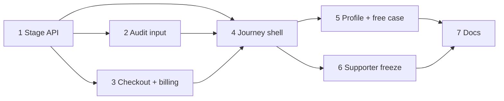

# UX redesign: Hành trình theo giai đoạn

## Overview
Workspace hiện chia theo loại dữ liệu (soạn thảo, tài liệu, báo cáo, lượt). Mỗi dịch vụ tự đặt chỗ mua, chấm, hiển thị riêng → 8 đường mua, kết quả ở 2 tab, giai đoạn này chặn giai đoạn kia mà không nói là giai đoạn nào.
Chuyển sang: **Hành trình → chi tiết giai đoạn (Soạn thảo · Tài liệu nộp · Kết quả chấm)**, Tổng quan = "Việc tiếp theo". Breaking change chấp nhận được.

Thiết kế: [docs/ux-redesign/](../../docs/ux-redesign/) (`00`–`06` SVG).

## Decisions (chốt 2026-10-11)
- UI gọi tên giai đoạn: **Ý tưởng · Thị trường · Sản phẩm & mô hình · Gọi vốn & tài chính**. `CP1..CP4` chỉ là mã nội bộ.
- Sidebar cố định 5 mục: Tổng quan dự án, Hành trình, Lượt chấm & thanh toán, Lịch sử hoạt động, Cài đặt. Không xổ con. Giai đoạn và dịch vụ hiện ở vùng chính.
- Tạo dự án miễn phí, không chọn gói. Chỉ trả tiền khi bấm chấm. Không còn tự chấm sau khi mua hoặc nộp hồ sơ.
- Mua lượt: một `ServiceCheckoutModal({ serviceCode })`. Quản lý số dư, lịch sử: chỉ tab "Lượt chấm & thanh toán".
- Đầu vào chấm mọi giai đoạn: câu trả lời template của giai đoạn hiện tại + các giai đoạn trước (bỏ câu trống) + file nộp của giai đoạn. **Phải có ít nhất một**: giai đoạn đã trả lời ≥1 câu template, hoặc có ≥1 file. Không có cả hai → 409 trước khi trừ lượt. Không gộp template theo nghĩa.
- Trạng thái giai đoạn **suy ra** từ dữ liệu (checkpoint, file, câu trả lời, job, report). Không thêm cột, không state machine mới. `user_facing_stage` giữ nguyên cho admin/thống kê; UI sinh viên không đọc nữa.
- Mỗi dự án chấm **một giai đoạn một lúc** (giữ khóa hiện tại). Bấm chấm khi giai đoạn khác đang chấm → Mantine notification màu đỏ "Đang chấm <tên giai đoạn>".
- Intake → "Hồ sơ dự án": thông tin cơ bản + file giai đoạn Ý tưởng + một ô "Ghi chú thêm" có quote hướng dẫn.
- Supporter đóng băng: xóa import, route mount, nhánh redirect; file giữ lại kèm `@deprecated`. Không comment code.
- Thảo luận ẩn. Thay bằng thẻ nhóm Zalo; URL lấy từ `NEXT_PUBLIC_ZALO_GROUP_URL` (root `.env`), dùng cho cả landing và AppShell.
- Ẩn nút "Xác nhận hoàn thành" (T17) ở UI sinh viên. Mua lượt không còn bị khóa theo stage `completed`, nên **create-order bỏ `T19_REOPEN`** (hiện đẩy case `done` về `supporter_working` + SLA) và trả `409 CASE_CLOSED` cho case `cancelled`. T17 giữ nguyên.
- Feature flag (CLAUDE.md §14), mặc định tắt, bật từng môi trường:
  - `NEXT_PUBLIC_JOURNEY_WORKSPACE` (web): `true` → workspace mới, `false` → giữ nguyên workspace cũ. Tab cũ chỉ xóa sau khi bật ổn định trên prod (phase 7).
  - `AUDIT_STAGE_INPUT_RULES` (api): `true` → luật đầu vào mới + bỏ tự chấm; `false` → hành vi cũ.
  - Biến `NEXT_PUBLIC_*` được nhúng lúc build: phải thêm vào build args của Dockerfile web, compose và CI.
- Workspace sinh viên responsive phone.
- Ngoài phạm vi: prompt chấm Sản phẩm/Gọi vốn, sửa hàng đợi BullMQ (cần triệu chứng cụ thể, việc riêng), xóa hẳn code supporter.

## Phases

| Phase | Name | Status |
|-------|------|--------|
| 1 | [Stage API foundation](./phase-01-stage-api-foundation.md) | Pending |
| 2 | [Audit input rules](./phase-02-audit-input-rules.md) | Pending |
| 3 | [Service checkout and billing tab](./phase-03-service-checkout-and-billing.md) | Pending |
| 4 | [Journey workspace shell](./phase-04-journey-workspace-shell.md) | Pending |
| 5 | [Project profile and free case creation](./phase-05-project-profile-and-free-case.md) | Pending |
| 6 | [Supporter freeze and Zalo contact](./phase-06-supporter-freeze-and-zalo.md) | Pending |
| 7 | [Docs, wording, changelog](./phase-07-docs-wording-changelog.md) | Pending |

## Rollback
Tắt flag là quay về hành vi cũ, không cần deploy lại API; web cần build lại vì `NEXT_PUBLIC_*` nhúng lúc build. Thay đổi API phase 1 đều là tham số optional. Không migration DB.

## Safety
Không `prisma migrate dev` (trừ `--create-only`), không `db push`, không lệnh xóa dữ liệu. Phase này không cần migration.
