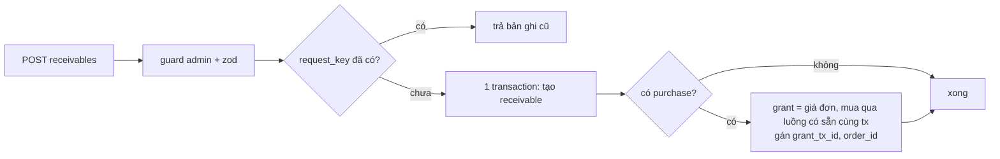

# Phase 3: Backend: tạo nợ + cấp ví, ghi thanh toán, xoá nợ, danh sách

## Context Links

- [Phase 2](./phase-02-receivables-schema.md)
- `apps/api/src/modules/wallet/application/wallet.service.ts`
- `apps/api/src/modules/wallet/infrastructure/persistence/wallet.repository.ts`
- `docs/shared-validation-convention.md`

## Overview

- Priority: P1.
- Status: Pending, chờ phase 2.
- Module mới `receivables` (Clean Architecture: domain/application/infrastructure/http) hoặc đặt trong `wallet` theo kết luận phase 1.

## Key Insights

- `deposit` không dùng lại được (hardcode `type: 'deposit'`, 3 caller). Thêm `WalletService.grant` dùng đúng ba hàm repository: `getOrCreateWalletInTx` (khoá `FOR UPDATE`), `createTransaction`, `updateWalletBalance`.
- **`createOrderUseCase` không composable hôm nay**: tự mở `prisma.$transaction` (`create-order.usecase.ts:L83`), trừ ví bằng `walletService.withdraw` (`type: withdrawal`, `referenceType: order`), ghi `creditLedger` purchase với `metadata_json.price_per_credit` (L190-193), phát `ORDER_PAID` (L210-229) khiến CP1 tự chạy audit nếu không `manual_trigger`, và ép `case.owner_auth_user_id === userId` (L162-163). Plan phải refactor, không chỉ truyền `tx`.
- Không có endpoint cấp ví đứng riêng và không có số cấp nhập tay. Cấp ví chỉ xảy ra trong `createReceivable`, bằng giá đơn, cùng transaction với việc mua.
- **Hoàn tiền an toàn bằng giá mua 0, không sửa code hoàn tiền**: đơn tài trợ ghi `price_per_credit: 0` vào `creditLedger.metadata_json` (kèm `funded_by_receivable_id`). `planServiceRefund` coi là `hasFreePurchase`, hoàn 0đ cho phần đó, sổ lượt vẫn về 0. Lý do chọn: dùng cơ chế đã có và đã có test; "đảo ngược về `platform_bonus`" cần logic ví mới.
- **Bất biến cứng: một cặp (case, loại dịch vụ) tài trợ không bao giờ trộn lượt mua thật.** Số dư lượt và FIFO hoàn tiền đều tính theo `(case_id, service_type_id)` nên phạm vi bất biến cũng là cặp đó; một case có thể có CP1 tài trợ và CP2 mua thật. `planServiceRefund` định giá số dư còn lại theo `created_at desc` và việc tiêu thụ không gắn nhãn lô, nên trộn lượt 0đ với lượt mua thật trong cùng cặp có thể hoàn thiếu tiền khách đã trả. Không chấp nhận hoàn thiếu như giới hạn v1. `createOrderInTx` khoá hàng case (`FOR UPDATE`) rồi từ chối (409) nếu: (a) đơn tài trợ vào cặp đã có lượt mua thật, hoặc (b) đơn mua thường vào cặp đã có lượt tài trợ. Lượt tài trợ nhận ra bằng `metadata_json.funded_by_receivable_id` trên `creditLedger` purchase. Phase 1 mục 13 xác nhận `createOrderInTx` là đường ghi `creditLedger` purchase duy nhất; có đường khác thì áp cùng kiểm tra. Một cặp đã tài trợ được tài trợ thêm; mỗi đơn là một lô và một khoản nợ riêng, nên hoàn tiền phải phân bổ theo lô (mục dưới), không tra khoản nợ chỉ bằng case + loại dịch vụ.
- **Huỷ/hoàn tiền đóng nợ nguyên tử, phân bổ theo từng lô.** Một cặp (case, loại dịch vụ) có thể có nhiều lô tài trợ (mỗi đơn một khoản nợ). Hàm `settleReceivableForRefundedCreditsInTx(tx, caseId, serviceTypeId, refundedCredits, eventKey)`: (1) lấy các dòng `creditLedger` purchase của cặp; mỗi dòng mang `funded_by_receivable_id`; sắp `created_at desc`, đúng thứ tự `planServiceRefund`. (2) Với số dư hiện tại `U` (trước lần hoàn), gán lượt chưa dùng cho lô mới nhất trước: `unused_i = min(credits_i, U − Σ unused các lô mới hơn)` (cùng giả định với FIFO hiện có: lô cũ dùng trước). (3) Phân bổ `refundedCredits` cho các lô theo cùng thứ tự, không vượt `unused_i`; tổng phân bổ phải bằng `refundedCredits`, lệch thì rollback. (4) Với mỗi khoản nợ có phần phân bổ `a > 0`, tính lũy kế riêng của nó: `cum = SUM(adjustments kind=refund .credits của receivable đó) + a`; `target = round(amount_due × cum / creditsGranted)` (`creditsGranted` từ đơn của chính nó qua `order_id`); `delta = min(còn nợ, target − SUM(adjustments kind=refund .amount))`; ghi một dòng `receivable_adjustments` (`kind=refund`, `credits=a`, `amount=delta`, `idempotency_key = refund:${eventKey}:${receivable_id}`). Trùng khoá thì P2002 là replay, bỏ qua. Tính theo **`amount_due`** (giá bán, có thể có markup) không theo giá đơn. Xoá tay (`kind=manual`) tách riêng. Khách đã trả nhiều hơn phần dịch vụ đã giao: phần dư là tiền phải trả lại khách, ngoài phạm vi. Gọi từ ba đường: `refundRemainingCreditInTx` (cả xoá case), `refundCaseAllInTx`, `admin_veto` (L102-103; case tài trợ không hoàn `lockedPrice`, chỉ xoá nợ).
- Ghi thanh toán phải khoá hàng `receivables` (`FOR UPDATE`) để hai lần ghi đồng thời không vượt số còn nợ.

## Requirements

Dùng chung: guard admin (`getAdminSession` như `listAdminUsersHandler`), số tiền là số nguyên VND, schema zod ở `packages/validation`.

1. `createReceivable({ requestKey, customerName, customerContact, caseId?, amountDue, dueAt, beneficiaryUserId?, purchase?: { packageId, quantity, caseId, manualTrigger? } })`:
   - **Loại lượt (CP1 hay CP2) do gói quyết định, không do khoản nợ.** `resolveOrderPackage` đọc `ServicePackage.service_type` và `credits_granted`; ví dụ `pkg_ai_audit` (79k, `cp1_audit`, 2 lượt) và `pkg_cp2_audit` (79k, `cp2_audit`, 2 lượt). Dòng `creditLedger` ghi `service_type_id` của gói và số dư tính theo `(case_id, service_type_id)`. API và `receivables` không nhận `serviceTypeCode`; UI hiển thị tên loại (`service_type.name`) lấy từ gói để admin xác nhận.
   - Trước transaction: tìm theo `request_key`; đã có thì trả bản ghi cũ `replayed: true` (khác số tiền/gói thì 409). Một transaction: tạo `receivables`; nếu có `purchase`: gọi `createOrderInTx(tx, beneficiary, ...)` với cờ tài trợ để tính giá đơn và ghi `price_per_credit: 0`, `WalletService.grant(beneficiary, giáĐơn)` ngay trước bước trả, rồi gán `grant_tx_id`, `order_id`. P2002 (đua `request_key`) bắt **ngoài** transaction rồi tra lại, vì lỗi trong transaction làm hỏng nó.
   - `beneficiaryUserId` bắt buộc khi có `purchase` và **phải là chủ case** (`owner_auth_user_id`), do `createOrderInTx` đòi. Khách Zalo chưa có tài khoản thì case thuộc tài khoản vận hành. Hàm chính sách `isAllowedGrantBeneficiary` (application logic, không ràng buộc DB; mặc định `admin`, `supporter`, `writer`, từ chối `user`; hằng số một chỗ) chỉ để chặn cấp nhầm ví khách. Người gọi vẫn phải là admin.
   - Tổng đơn tối đa `GRANT_MAX_VND = 1_000_000`. Khi có `purchase`: `amountDue >= giáĐơn`, nếu không nợ nhỏ hơn tiền đã cấp. Giá đơn 0 (giảm 100%): không cấp, không gọi `grant`. `manualTrigger` mặc định `true` để audit không tự chạy (tốn chi phí) trước khi khách trả; admin chủ động chạy.
   - Khoá idempotency: ví `grant:${requestKey}`; đơn dùng khoá riêng suy ra từ `requestKey`. `metadata` giao dịch cấp: `{ actorId, receivableId }`. Phát `WALLET_BALANCE_CHANGED` chỉ khi phase 1 xác nhận consumer vô hại.
   - `code`: sinh phía server, duy nhất, dễ gõ làm nội dung chuyển khoản.
2. `recordPayment(receivableId, { grossAmount, bankRef, paidAt, source })` dùng chung cho nhập tay và webhook:
   - Khoá `receivables` `FOR UPDATE`. `applied = min(grossAmount, còn nợ)`. Nhập tay: từ chối nếu `grossAmount` > còn nợ (409), nên `applied = gross`. Webhook: ghi một dòng với `gross_amount = transferAmount` và `applied_amount = applied`, không cắt `gross`. `bank_ref` trùng thì không ghi (P2002 bắt ngoài transaction; webhook coi là replay thành công).
3. `writeOff(receivableId, { amount, reason, requestKey })`: ghi một dòng `receivable_adjustments` (`kind=manual`, `idempotency_key = manual:${requestKey}`); `amount` ≤ còn nợ, `reason` bắt buộc. Không hoàn tác trong v1.
4. `listReceivables({ status?, search?, page })`: trả `paid`, `outstanding`, `status` tính từ dữ liệu: `settled` (còn nợ = 0 và đã thu > 0), `written_off` (còn nợ = 0 và đã thu = 0), `partial`, `overdue` (còn nợ > 0 và quá `due_at`), `open`; kèm cờ `needs_review` nếu `review_reason` khác rỗng.
5. Hằng số/enum trạng thái và hàm tính ở một chỗ (`domain`), cả danh sách và kiểm tra thanh toán dùng chung.
6. **Tự khớp thanh toán qua SePay (dùng lại luồng có sẵn).** `sepay-webhook.usecase.ts` hiện bắt mã `CR[A-Z0-9]{6,}` rồi tra `Deposit`. Thêm nhánh: mã bắt đầu `CRDEBT` thì tra `receivables.code` (trước khi tra `Deposit`); **không** gọi `walletService.deposit` và **không** tạo `Deposit`. Khớp thì `recordPayment({ grossAmount: transferAmount, bankRef: String(txnId), source: 'sepay' })` trong transaction, không đòi đúng số tiền: thiếu thì `partial`. **Chuyển dư hoặc khoản nợ đã hết**: vẫn ghi một dòng với `gross_amount = transferAmount` và `applied_amount = min(transferAmount, còn nợ)` (có thể 0), đặt `review_reason` (`overpaid` kèm số dư) để đối soát và hoàn lại khách. Còn nợ chỉ trừ `applied_amount`; tiền thật không bao giờ bị cắt khỏi sổ. Trùng `txnId` (SePay gửi lại) thì P2002, trả kết quả cũ. Mã `CRDEBT…` không khớp `receivables.code` nào: trả `no_match` và ghi log, **không** rơi sang nhánh `Deposit`.
7. **Trang thanh toán công khai theo token (dữ liệu cho trang payment dùng lại).** `GET /public/receivables/:token`, không cần đăng nhập, có giới hạn tần suất. Băm token rồi tra `public_token_hash`. Trả DTO tối thiểu: `code`, `amountDue`, `outstanding`, `status` (tính từ dữ liệu), `createdAt`, `paidAt` (nếu đã thu đủ), `bankInfo` từ `getDepositBankInfo(code, outstanding)`. **Không** trả tên, liên hệ khách, `case_id`, `order_id`, `grant_tx_id`, `review_reason`, id nội bộ. Token sai, chưa cấp hoặc đã bị xoay: 404 cùng một nội dung. `createReceivable` **không** tạo token. `POST admin/receivables/:id/payment-link` tạo token (lưu hash, trả token gốc và `payUrl` một lần); gọi lại là xoay, hiệu lực ngay, link cũ chết. Dùng cho cả lần đầu (sau khi có kết quả, đúng lúc gửi link) và khi nghi lộ link hoặc mất link. Log truy cập (Next, reverse proxy, API) phải che phân đoạn `:token` của `/pay/*` và `/public/receivables/*`; `no-referrer` chỉ chặn rò rỉ qua trình duyệt, không chặn được log máy chủ. Không tạo bảng, không tạo `Deposit`.

Non-functional: không sửa `deposit`; mọi thao tác ghi ví/nợ trong transaction; không xoá hàng.

## Architecture

Thanh toán tự động: SePay webhook → mã `CRDEBT…` → khoá hàng → ghi `receivable_payments` (`source=sepay`). Thanh toán tay: `POST receivables/:id/payments` → khoá hàng → kiểm còn nợ và `bank_ref` → ghi. Mã QR: `GET receivables/:id/payment-info` dùng lại `getDepositBankInfo`.

## Related Code Files

Sửa: `wallet.service.ts` (thêm `grant`), `apps/api/src/modules/orders/application/create-order.usecase.ts` (tách `createOrderInTx`, cờ tài trợ, khoá case và kiểm không trộn lô; test order hiện có phải xanh nguyên), `apps/api/src/services/credit-refund.ts` và `case-transition.service.ts` (gọi `settleReceivableForRefundedCreditsInTx`; `admin_veto` không hoàn `lockedPrice` cho case tài trợ), `apps/api/src/modules/payments/application/sepay-webhook.usecase.ts` (nhánh `CRDEBT`, không đổi nhánh `Deposit`; test webhook hiện có xanh nguyên), file đăng ký route admin, `packages/validation`.
Tạo: use case `create-receivable`, `record-receivable-payment`, `write-off-receivable`, `list-receivables`, `get-public-receivable` (dùng `getDepositBankInfo`); repository `receivables`; handler/route admin và route công khai `/public/receivables/:token` (theo cách đăng ký route công khai hiện có, ví dụ webhook SePay); hàm tính trạng thái ở `domain`; test trong `apps/api/src/shared/infrastructure/tests/`.
Xoá: không.

## Implementation Steps

0. Refactor `createOrderInTx` trước, chạy test order hiện có xanh, rồi mới viết phần còn lại.
1. `WalletService.grant` + đoạn `domain` tính còn nợ/trạng thái.
2. Repository `receivables` (kèm khoá `FOR UPDATE`).
3. Bốn use case, rồi handler và route theo mẫu admin hiện có.
4. Schema zod chung.
5. Test. Chạy `bun run --filter nexus-platform-api test` và `bun run check-types`.

## Todo

- [ ] `WalletService.grant`
- [ ] Hàm tính trạng thái và còn nợ (`domain`)
- [ ] `createReceivable` (+ cấp ví nguyên tử)
- [ ] `recordPayment`, `writeOff`, `listReceivables`
- [ ] Route + guard admin
- [ ] Test và `check-types` xanh

## Success Criteria

Test hành vi bắt buộc:

- Tạo nợ có `purchase`: đúng một `WalletTransaction` `adjustment`/`platform_bonus` (`source_id = receivable.id`) và đúng một `withdrawal` với `source_type = order`, `source_id = order.id`; `grant_tx_id` và `order_id` gán đúng. Dòng `creditLedger` purchase có `price_per_credit: 0`.
- Nguyên tử: lỗi khi cấp ví thì không có `receivables` nào; lỗi sau khi tạo nợ thì ví không đổi.
- Replay cùng `request_key`: không tạo nợ thứ hai, không cấp thêm.
- Không có cấp mồ côi: không có route nào ghi `platform_bonus` ngoài `createReceivable`, và không có đầu vào số tiền cấp tự do.
- Ghi thanh toán tay: một phần, hai phần cộng đủ thì `settled`; vượt còn nợ bị 409; `bank_ref` trùng không ghi lần hai.
- **Webhook SePay `CRDEBT`:** chuyển đủ thì `settled`; chuyển thiếu thì `partial`; chuyển dư (nợ 100.000, chuyển 130.000) thì dòng có `gross_amount = 130.000`, `applied_amount = 100.000`, `overpaid = 30.000`, nợ về 0, `review_reason` đặt; khoản nợ đã `settled` nhận thêm tiền thì dòng mới có `applied_amount = 0`, `gross_amount` đầy đủ; SePay gửi lại cùng `id` thì không ghi hai lần; mã `CRTOPUP…` (nạp ví) vẫn đi nhánh `Deposit` cũ và cộng ví như cũ (test webhook hiện có xanh); **thanh toán nợ không tạo `Deposit` và không có giao dịch `deposit` nào trong ví**; mã `CRDEBT…` không khớp thì `no_match`.
- **Chuyển dư, ví dụ cụ thể:** còn nợ 79.000, SePay báo 100.000 (`id = 5001`): đúng một dòng `receivable_payments` với `gross_amount = 100.000`, `applied_amount = 79.000`, `bank_ref = "5001"`; `overpaid = 21.000`; nợ về 0; `review_reason` đặt. SePay gửi lại cùng `id = 5001` (hoặc hai webhook song song): vẫn một dòng, `gross` tổng không nhân đôi, `overpaid` vẫn 21.000. Tổng `SUM(gross_amount)` luôn khớp tổng tiền thật vào tài khoản, không bao giờ nhỏ hơn.
- **Trang công khai theo token:** token hợp lệ trả đúng DTO tối thiểu và **không** chứa tên, liên hệ, `case_id`, `order_id` hay `review_reason`; token sai và token tương tự (đổi một ký tự) đều 404 giống nhau; sau khi webhook SePay ghi thanh toán đủ thì `status = settled` và `outstanding = 0`; `bankInfo.qrUrl` mã hoá đúng `outstanding` hiện tại (thanh toán một phần thì QR lần sau theo số còn lại); vượt giới hạn tần suất thì 429.
- **Token:** DB không chứa token gốc (chỉ hash); sau `rotate-token` link cũ trả 404 và link mới hoạt động; response tạo/xoay là nơi duy nhất trả token gốc; `GET admin/receivables/:id` không trả lại token gốc. Log truy cập che token (kiểm trong cấu hình log của API và Next; nếu không che được ở reverse proxy thì ghi rõ trong runbook).
- Hai request thanh toán đồng thời không vượt tổng còn nợ.
- Xoá nợ vượt còn nợ hoặc thiếu lý do bị từ chối. Còn nợ bằng 0 nhờ xoá nợ ra `written_off`.
- `overdue` chỉ khi còn nợ > 0 và quá hạn.
- Số tiền 0, âm, thập phân, vượt `GRANT_MAX_VND`: bị từ chối. Caller không phải admin: 403. Người nhận cấp không thuộc chính sách cho phép: 400. Đổi hằng số chính sách thì kết quả đổi theo, không cần sửa DB.
- Giao dịch cấp không bị tính vào doanh thu admin (theo phase 1).
- Smoke DB local: tạo nợ kèm cấp, mua lượt bằng luồng mua có sẵn, ghi hai lần thanh toán, danh sách đúng.
- Mua hộ nguyên tử: sau `createReceivable` có `purchase`, số dư ví người nhận không đổi (cấp +X, đơn -X), case nhận đúng số lượt, `order_id` đúng. Lỗi ở bước mua (giá, hết gói, không phải chủ case) thì không còn nợ, không còn giao dịch cấp. Dùng transaction thật, không mock: mock không chứng minh được nguyên tử.
- **Đầu vào một bước:** thiếu `caseId` hoặc `packageId` khi có `purchase` bị 400; `caseId` không tồn tại thì 404; case không thuộc `beneficiaryUserId` bị 403; gói không bán hoặc hết hiệu lực bị 400; `amountDue` thấp hơn giá đơn bị 400. Mỗi trường hợp không để lại nợ, giao dịch cấp hay đơn nào. Lỗi đã rollback rồi gọi lại **cùng `requestKey`** sau khi sửa dữ liệu thì tạo bình thường.
- **Retry sau timeout:** lần đầu đã ghi thành công nhưng client không nhận được phản hồi; gọi lại cùng `requestKey` và cùng dữ liệu thì trả bản ghi cũ (`replayed: true`), không có nợ, đơn hay giao dịch cấp thứ hai; gọi lại cùng `requestKey` nhưng đổi case, gói, số lượng hoặc `amountDue` thì 409 và không ghi gì. Hai request đồng thời cùng `requestKey` chỉ tạo một khoản nợ.
- **Hoàn tiền không tăng ví người nhận**: `refundRemainingCreditInTx`, `refundCaseAllInTx` (hoàn toàn bộ, và hoàn một phần sau khi dùng một lượt), xoá case, `admin_veto`, đều cho số dư ví người nhận không tăng khi mọi lượt là tài trợ.
- **Bất biến không trộn lô (mọi đường mua):** mua thường vào case đã tài trợ bị 409; đơn tài trợ vào case đã có lượt mua thật bị 409; hai request đồng thời (một tài trợ, một mua thường) vào cùng case thì đúng một thành công. Kiểm từng đường ghi `creditLedger` purchase tìm thấy ở phase 1 mục 13. Không có test nào chấp nhận hoàn thiếu.
- **Hoàn/huỷ đóng nợ nguyên tử** với `refundRemainingCreditInTx`, `refundCaseAllInTx`, xoá case, `admin_veto`: ví không tăng; lỗi giữa chừng thì nợ không đổi; hoàn lần hai cùng `eventKey` không xoá nợ lần hai (unique `idempotency_key`).
- **Lũy kế đúng tổng, một lô:** `amount_due = 120.000`, đơn `79.000`, 2 lượt: huỷ toàn bộ thì nợ về 0 (không treo 41.000); huỷ 1 trong 2 lượt thì xoá 60.000; dùng 1 rồi huỷ nốt lượt còn lại thì tổng xoá 60.000. Số lẻ `amount_due = 100.001`, 3 lượt, hoàn từng lượt qua 3 sự kiện: các `delta` là 33.334, 33.333, 33.334 (tổng 100.001, cộng dồn đúng bằng `round(100.001 × k/3)`); hoàn 2 lượt một lần rồi 1 lượt một lần cho cùng tổng 100.001. Khách đã trả trước một phần: `delta` bị chặn bởi còn nợ, không âm; xoá tay (`manual`) không làm lệch lũy kế `refund`.
- **Nhiều lô trong cùng cặp (case, CP1):** nợ A (đơn cũ, 2 lượt, `amount_due = 120.000`) và nợ B (đơn mới, 2 lượt, `amount_due = 100.000`). Dùng 1 lượt (lô cũ A dùng trước), còn 3 lượt: hoàn cả 3 thì B nhận 2 lượt (xoá 100.000), A nhận 1 lượt (xoá 60.000). Hoàn 1 lượt thì gán B (lô mới nhất): xoá 50.000 của B, nợ A không đổi. Không có đường nào xoá nợ của khoản nợ khác lô. Mỗi khoản nợ có `idempotency_key` riêng; replay cùng `eventKey` không xoá thêm cho bất kỳ khoản nợ nào. Phân bổ lệch tổng thì rollback, không ghi gì.
- Giá đơn 0: không có giao dịch `platform_bonus`. `amountDue < giáĐơn`: bị từ chối.
- Doanh thu admin không tính đơn có `receivables.order_id` và không tính `payment` dual-write của đơn đó (phase 1 mục 10).
- `createOrderInTx` giữ nguyên hành vi cũ cho caller cũ (test order hiện có xanh).

## Risk Assessment

- Cấp nhầm ví: chặn bằng hàm chính sách người nhận và tối đa `GRANT_MAX_VND`. Chính sách mặc định dựa trên danh sách role trong code, chưa có bằng chứng operator dùng role nào; phase 1 mục 8 xác nhận.
- Hai request tạo nợ đồng thời cùng `request_key`: tra trước transaction, bắt P2002 ngoài transaction rồi trả bản ghi đã có (trong Postgres, lỗi unique trong transaction làm hỏng cả transaction).
- Lệch giữa trạng thái tính ở danh sách và kiểm thanh toán: dùng chung một hàm `domain`.

## Security Considerations

- Chỉ admin. Ghi `created_by`/`recorded_by`.
- Không log thông tin liên hệ khách ngoài cần thiết.
- Không chạy Prisma/DB ngoài DB local.

## Next Steps

Phase 4 và 5.
