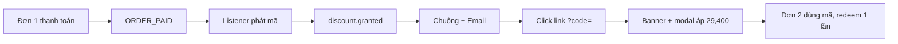

# Phase 7: Kiểm thử và triển khai

## Context Links
- [plan.md](./plan.md)
- `.agents/rules/prisma-migration-safety.md`
- `docs/db-backup-guide.md`, `docs/vps-deployment-guide.md`, `docs/docker-build-push-guide.md`

## Overview
- Priority: P1
- Status: Pending
- Chưa có lần chạy thật nào. Phase này chứng minh luồng đầu-cuối trên môi trường an toàn, rồi lên VPS.

## Key Insights
- DB local `nexus-db` (postgres:18.4, volume cục bộ) có 15 users, 31 orders (mới nhất 2026-10-20): nhiều khả năng là bản restore prod, lịch sử migration lệch repo (4 migration lạ). Không dùng cho smoke mua thật nếu chưa được user cho phép.
- `.env` local có Resend key thật (kiểm 2026-11-07: `RESEND_API_KEY` set, 36 ký tự; `DATABASE_URL` và `READONLY_DATABASE_URL` đều `localhost:5432/nexus_platform`). User chọn smoke trên DB local hiện tại. Không được để `RESEND_API_KEY` rỗng: `auth.ts` gọi `requiredEnv('RESEND_API_KEY')` nên API không khởi động. Chặn mail thật bằng cách chạy API với key giả khác rỗng, ví dụ `RESEND_API_KEY=re_disabled_local` (Resend từ chối, không gửi), kèm `APP_BASE_URL=http://localhost:3001`; chỉ dùng tài khoản test. Trước seed hoặc lệnh ghi nào, kiểm lại host là localhost (đọc-only).
- Độ trễ mong đợi: ORDER_PAID relay 5s + discount.granted relay 5s + notification relay 2s ≈ 12s.
- Mã phát sau lần mua đầu, nên cần ít nhất 2 đơn để thấy toàn chu trình.

## Requirements
- Migration và drift được kiểm trên DB sạch.
- Kiểm thử từng file; không chạy cả bộ API.
- Smoke đầu-cuối có bằng chứng (SELECT, screenshot).
- Triển khai VPS theo thứ tự an toàn, có backup.

## Architecture

## Related Code Files
Không sửa code. Test chạy: `first-purchase-discount.test.ts`, `phase-03-discount-codes.test.ts`, `discount-single-unit.test.ts` (Phase 2), file test admin (Phase 5).

## Implementation Steps
1. Postgres sạch: `docker run` container mới (cổng khác, volume riêng) → `prisma migrate deploy` đủ 50 migration → `prisma migrate diff --from-migrations … --to-schema-datamodel … --shadow-database-url <local>` xác nhận không drift (chỉ DB local, không prod).
2. Seed: `seed-active-packages.ts` lên DB sạch; SELECT xác minh 49000/1.
3. Test từng file; build `packages/validation` trước; `tsc --noEmit` api + web-1.
4. Smoke (API + web local, `NOTIFICATIONS_ENABLED`/Resend tắt hoặc gửi tới hộp thư test, `APP_BASE_URL=http://localhost:3001`):
   - Nạp ví test, mua 1 gói → SELECT `discount_codes` có 1 dòng đúng owner/case/service; `notifications` có `discount.granted`.
   - Chuông hiện mã; click link → banner + 29,400 VND; mua → `discount_redemptions` có 1 dòng, `redeemed_count` = 1.
   - Dùng lại mã → bị từ chối; tài khoản khác dùng mã → bị từ chối.
   - Kịch bản pay-later (funded) → không có mã.
   - Mua N=3 có mã → đúng tổng 127,400 VND.
   - Chụp screenshot 390px và 1440px.
5. Tài liệu: cập nhật `plans/reports/research-261107-price-split-49k-vs-50k.md` (mục 7), docs deploy (biến env mới), changelog nếu repo có.
6. VPS (sau khi user xác nhận): backup DB → `prisma migrate deploy` → deploy API → deploy web → chạy seed → kiểm cache trang pricing → theo dõi log listener.

## Todo List
- [ ] DB sạch + migrate deploy + diff
- [ ] Seed + SELECT
- [ ] Test từng file + typecheck
- [ ] Smoke đầu-cuối có bằng chứng
- [ ] Cập nhật docs/report
- [ ] Backup + deploy VPS (có xác nhận)

## Success Criteria
- `migrate diff` rỗng.
- Toàn bộ kịch bản smoke ở bước 4 đạt, có SELECT và screenshot.
- VPS: gói hiển thị 49,000 VND; đơn thật đầu tiên sinh mã và thông báo.

## Risk Assessment
- Migration chưa chạy trước API mới → listener ghi cột chưa có và lỗi (chỉ log, đơn không hỏng). Luôn migrate trước.
- Listener lỗi giữa chừng không tự thử lại → mã không phát; cách xử lý: admin tạo tay. Cân nhắc quét bù sau.
- Gửi mail thật nhầm khách khi test: dùng tài khoản test.
- Rollback: tắt phát mã bằng cách gỡ `initFirstPurchaseDiscountListener()`; giá hoàn lại bằng seed giá cũ; hai cột mới nullable nên để nguyên không hại.

## Security Considerations
- Chỉ dùng `READONLY_DATABASE_URL` để đọc prod; không lệnh phá hủy. Không in secret/key vào log hoặc báo cáo.
- Kiểm endpoint kiểm mã vẫn giới hạn tần suất (chống dò mã).

## Next Steps
Sau 1–2 tuần: đo số mã được dùng / mã phát, tỉ lệ mua lượt 2, để đánh giá giá 49k và mức 40%.
