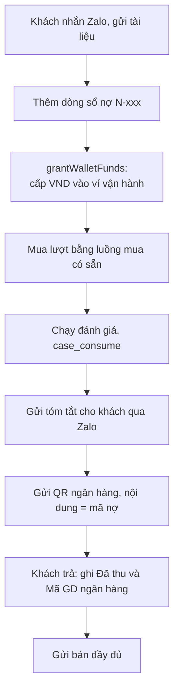

# Brainstorm: "Làm trước, thanh toán sau" cho khách đến từ Zalo

Ngày: 2026-10-16
Trạng thái: **thiết kế chưa duyệt, chưa có code, chưa chạm DB**
Phạm vi: chỉ brainstorm. Kế hoạch triển khai chưa tạo.

## 1. Vấn đề

- Khách nhắn Zalo xin đánh giá, gửi tài liệu qua Zalo.
- Vận hành (user) muốn chạy đánh giá trước, để khách thấy giá trị, rồi mới gửi QR thu tiền.
- Không thể đòi QR trước khi khách thấy giá trị.
- Ví vận hành không đủ tiền để mua lượt đánh giá trên web.
- Khách không mua credit trong luồng này. Khách chỉ trả tiền cho dịch vụ sau khi nhận kết quả.

Cần hai thứ tách biệt:

1. Cách có credit để chạy đánh giá (phía hệ thống).
2. Sổ ghi khoản khách còn nợ (phía tiền thật).

## 2. Ràng buộc và sự thật đã xác minh trong code

| Sự thật | Nguồn |
|---|---|
| Có hai lớp "credit": ví VND (`WalletTransaction`) và lượt chấm theo case (`creditLedger`, theo `case_id` + `service_type_id`) | `credit-ledger.repository.ts`, `wallet.types.ts` |
| Số dư lượt của case = tổng `amount` trong `creditLedger` theo case và loại dịch vụ | `getCreditBalance` |
| Giao dịch ví có `type`, `sourceType`, `sourceId`, `idempotencyKey` (unique), `metadata` | `WalletTransactionDTO` |
| `sourceType` hợp lệ: `topup`, `credit_purchase`, `case_consume`, `admin_refund`, `case_refund`, `platform_bonus`, `migration`, `service_payment` | `wallet.types.ts` |
| `platform_bonus` chỉ xuất hiện ở danh sách kiểu và nhãn hiển thị. **Không tìm thấy chỗ nào ghi nó** (grep `apps/api/src`; chưa loại trừ nơi khác) | `wallet-display.constants.ts` |
| Hoàn tiền tính FIFO theo giá mua thật | `credit-refund.ts` (`planServiceRefund`, `resolvePurchaseUnitPrice`) |
| Admin có tạo user (`POST /admin/users`), mật khẩu gửi qua email | `CreateUserModal`, `useAdminUsers` |
| Production DB là tài nguyên cấm đụng trực tiếp; agent không được mutate prod | `.agents/rules/prisma-migration-safety.md` |

**Chưa xác minh** (phải đọc code trước khi lập kế hoạch):

- Hàm ghi giao dịch ví hiện có và chữ ký của nó. Có cột số dư trên `UserWallet` cần cập nhật không.
- `type` đúng của giao dịch cấp tiền: `adjustment` hay `deposit`.
- Báo cáo doanh thu và thống kê admin có lọc theo `sourceType` hay không. `service_payment` từ tiền tặng có bị tính như doanh thu thật không.
- Có endpoint admin để gắn vào hay phải tạo mới.
- Quan hệ giữa `sourceId`, `reference_id` và `case_id`.

## 3. Các phương án đã cân nhắc

### Cho phần "có credit để chạy"

| Phương án | Nhận định | Kết luận |
|---|---|---|
| Tự nạp tiền thật vào ví | Không cần code, nhưng đúng điều user không làm được | Loại |
| SQL tay trên prod | Bỏ qua bất biến sổ (`balance_after`, `idempotency_key`, FIFO). Vi phạm quy tắc an toàn DB | **Loại, không khuyến nghị** |
| `grantCaseCredits`: ghi thẳng dòng `creditLedger` cho case | Lượt tặng không có giá mua thật. FIFO hoàn tiền phải tự quyết giá. Tạo logic tiền mới chưa kiểm chứng. Nếu ghi `type: purchase` thì làm sai lịch sử mua | Loại |
| **`grantWalletFunds`: admin cấp VND vào ví vận hành, rồi dùng luồng mua lượt có sẵn** | Chỉ chạm ví. Mua lượt, hoàn tiền, job, sự kiện đều đi qua code đã dùng thật | **Chọn** |
| Ví âm / hạn mức nợ | Đụng logic tiền, cần audit, quá lớn cho vài khách | Loại |
| Order "chờ thanh toán", khoá kết quả tới khi trả | Đúng nghĩa pay-later, nhưng là tính năng lớn, bạn tự gánh chi phí AI | Chỉ khi thành chính sách bán hàng |

### Cho phần "sổ nợ"

| Phương án | Nhận định | Kết luận |
|---|---|---|
| Google Sheet | Nhỏ nhất, đủ cho vài khách. Chỉ tham chiếu chéo mã, không liên kết gốc | **Chọn cho giai đoạn đầu** |
| Bảng `receivables` trong DB (`user + case + amount`) | Liên kết gốc, tự đối soát. Cần migration | Khi có từ 3 khách/tuần cần trả sau hoặc có người thứ hai cùng ghi sổ |

## 4. Giải pháp khuyến nghị

### 4.1 `grantWalletFunds(userId, amountVnd, reason, receivableRef)`

- Quyền: chỉ admin đã xác thực.
- Một transaction DB, dùng lại hàm ghi giao dịch ví có sẵn.
- Ghi một dòng `WalletTransaction`: `sourceType: platform_bonus`, `sourceId: receivableRef`, `metadata` ghi admin thực hiện và lý do. `type` dự kiến `adjustment`, **chưa xác minh**.
- `idempotency_key` suy ra từ `userId + receivableRef`, bấm hai lần không cấp đôi.
- Không dùng `deposit` hay `topup` để khỏi lẫn với nạp tiền thật.
- Không ghi `creditLedger`. Lượt chấm chỉ phát sinh khi mua bằng luồng mua có sẵn, với giá mua thật.
- Đơn vị rõ ràng: tham số là VND, không dùng tên `grantCredit` mơ hồ.

### 4.2 Luồng vận hành

- Khách không mua credit. Tiền khách trả không tạo credit mới.
- QR là chuyển khoản ngân hàng **ngoài** luồng nạp ví của web. Đi qua web thì khách nhận thêm credit, lệch sổ.
- Credit đã cấp là phương tiện chạy. Chi phí thật nằm ở tính toán AI và công sức. Giá thu phải lớn hơn chi phí đó.

### 4.3 Sổ nợ (Google Sheet)

| Cột | Cách có |
|---|---|
| Mã nợ (`N-001`...) | Nhập tay. Dùng làm nội dung chuyển khoản và `receivableRef` |
| Khách, Zalo | Nhập tay |
| Case (`case_code`) | Nhập tay |
| Số lượt, Ngày giao, Hạn trả | Nhập tay |
| Phải thu | Nhập tay |
| Đã thu | Nhập tay, cộng từng lần chuyển |
| Mã giao dịch ngân hàng | Nhập tay, để đối chiếu sao kê |
| **Còn nợ** | `= Phải thu - Đã thu` |
| **Trạng thái** | **Tính từ các cột trên, không chọn tay**: `Còn nợ = 0` là đã trả; `Đã thu > 0` và `Còn nợ > 0` là trả thiếu; `Còn nợ > 0` và quá hạn là quá hạn |
| Xoá nợ (số tiền, lý do) | Cột riêng, tách khỏi thanh toán |
| Mã GD cấp VND | `id` giao dịch `platform_bonus` vừa tạo |

Dòng tổng ở đầu: tổng đang nợ, số khoản quá hạn.

Giới hạn thẳng thắn: sheet chỉ **tham chiếu chéo** mã bằng tay. Khách chưa từng mua credit nên không có lịch sử mua để nối. Muốn lịch sử nằm trong hệ thống thì phải có bảng khoản phải thu. Hiện chưa đáng làm.

## 5. Rủi ro

| Rủi ro | Xử lý |
|---|---|
| Khách nhận kết quả rồi không trả | Mất tối đa chi phí vài lượt. Gửi tóm tắt trước, bản đầy đủ sau khi trả |
| Số liệu doanh thu bị nhiễu do `service_payment` từ tiền tặng | Kiểm báo cáo admin có lọc `sourceType` không, trước khi dùng |
| Cấp nhầm ví khách thay vì ví vận hành | Quy tắc: chỉ cấp cho ví vận hành. Cấp cho khách làm họ giữ credit miễn phí và nhận thêm khi trả |
| Hoàn tiền sau khi cấp trả VND về ví vận hành | Đúng về logic. Ghi nhận ở sổ nợ, không để tiền "tặng" tồn lại không ai thấy |
| Đổi dropdown nhầm đóng nợ | Trạng thái tính tự động, `Xoá nợ` là trường riêng có lý do |
| Mất dấu vết ai cấp, vì sao | `metadata` ghi admin thực hiện và lý do, `sourceId` ghi mã nợ |
| Đụng prod DB | Không SQL tay. Triển khai qua code đã deploy. Chạy trên prod là hành động riêng do user thực hiện ngoài agent |

## 6. Tiêu chí kiểm chứng

- Cấp hai lần cùng `receivableRef` chỉ cộng một lần.
- Số dư ví sau khi cấp đúng bằng số dư trước cộng số tiền cấp.
- Dùng tiền vừa cấp để mua lượt đi đúng luồng mua có sẵn và tạo đúng dòng `creditLedger`.
- Hoàn tiền sau khi mua trả lại VND về ví theo giá mua thật, không phát sinh khoản lạ.
- Không có dòng `deposit` hay `topup` nào được tạo bởi thao tác cấp.
- Giao dịch cấp hiển thị đúng nhãn "Hệ thống tặng thưởng" và không bị tính vào thống kê nạp tiền thật.

## 7. Điều đã sửa trong quá trình thảo luận

Các điểm review chỉ ra, đã nhận:

- `platform_bonus` là khoản tặng, không phải khoản phải thu. Nạp ví sau đó không "bù" credit đã cấp.
- Không dùng ví khách để cấp. Chỉ ví vận hành.
- Sổ nợ không được dựa vào dropdown trạng thái do người dùng chọn. Phải có `Đã thu`, mã giao dịch ngân hàng, và `Còn nợ` tính tự động.
- Loại SQL tay trên prod khỏi mọi đề xuất.
- Tên hàm không được mơ hồ giữa VND và lượt chấm.

Điểm tôi đã nhầm lúc đầu:

- Đã nói `platform_bonus` "đã có" nên có thể 0 code. Thực tế chỉ có nhãn, chưa thấy chỗ ghi.
- Đã đề xuất cấp thẳng lượt cho case, rồi đổi sang cấp VND vào ví để tái dùng toàn bộ luồng mua và hoàn tiền sẵn có.

## 8. Việc tiếp theo

Điều kiện: user duyệt thiết kế `grantWalletFunds` ở mục 4.

1. Đọc repository ví và luồng mua lượt để trả lời các điểm chưa xác minh ở mục 2.
2. Lập kế hoạch qua `/ck:plan`, gồm use case, endpoint admin, test.
3. Viết test cục bộ theo mục 6, chạy trên DB local.
4. Triển khai theo quy trình thường. Chạy trên prod là hành động riêng, theo `.agents/rules/prisma-migration-safety.md`, do user thực hiện ngoài agent.
5. Song song, tạo Google Sheet theo mục 4.3 nếu user muốn.

## 9. Ngoài phạm vi

- Order "chờ thanh toán" và khoá kết quả: chỉ làm khi "trả sau" thành chính sách bán hàng.
- Bảng `receivables` trong DB: chỉ làm khi có từ 3 khách/tuần cần trả sau hoặc có người thứ hai cùng ghi sổ.
- Ví âm / hạn mức nợ: không làm.
- Chính sách thuế và hoá đơn cho khoản thu qua QR ngoài hệ thống: chưa xét.

## 10. Cập nhật sau khi lập kế hoạch

Plan: [`plans/261016-1530-grant-wallet-funds-pay-later/plan.md`](../261016-1530-grant-wallet-funds-pay-later/plan.md) (`status: pending`, 4 phase). Mục 8 "điều kiện duyệt" đã được thay bằng plan này.

Đã xác minh thêm trong code (đọc `wallet.service.ts`, `wallet.repository.ts`):

- `WalletService.deposit` hardcode `type: 'deposit'`, luôn phát `WALLET_BALANCE_CHANGED`; 3 caller: `sepay-webhook.usecase`, `verify-deposit.usecase`, `refund`. Vì vậy **không dùng lại `deposit`** để cấp. Thêm `WalletService.grant` riêng, `type: adjustment`.
- `createTransaction` ghi `source_type = reference_type`, nhận `metadataJson`; `getOrCreateWalletInTx` khoá `FOR UPDATE`; `idempotency_key` unique. Đủ để cấp an toàn trong một transaction.
- Vẫn chưa xác minh (phase 1 của plan): enum `type` có `adjustment` không, consumer của `WALLET_BALANCE_CHANGED`, nguồn doanh thu admin có đếm giao dịch cấp không, vị trí route admin, mẫu test.

## 11. Đổi quyết định: nợ nằm trong DB

Mục 3 và 4.3 (sổ nợ ở Google Sheet) bị **thay thế**. Lý do: khoản nợ là lý do nghiệp vụ để tạo giá trị ví. Để nợ ở Sheet thì không chặn được khoản cấp mồ côi, và không đối soát được.

Thiết kế mới (xem plan, phase 2–3): hai bảng cộng thêm `receivables`, `receivable_payments`; không có endpoint cấp ví đứng riêng; `createReceivable` với `grantAmountVnd` tuỳ chọn tạo nợ và cấp ví trong cùng một transaction; còn nợ và trạng thái tính từ dữ liệu; `request_key` chống tạo đôi. Mục 8 "việc tiếp theo" xem plan `plans/261016-1530-grant-wallet-funds-pay-later/plan.md`.
